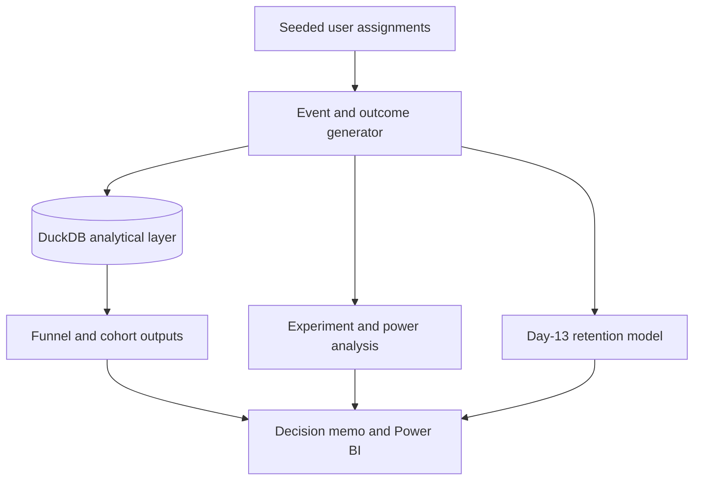

# Product Experimentation & Customer Analytics

[](https://github.com/RishiRatnakarData/product-experimentation-analytics/actions/workflows/ci.yml)

A reproducible product-analytics system that connects event modeling, user-level funnel and cohort SQL, controlled-experiment inference, experiment planning, and leakage-aware retention modeling to a launch decision.

> **Data disclosure:** The controlled experiment is simulated with a fixed seed and a documented 2.5-percentage-point treatment effect. Its results demonstrate analytical method and are not observations from a real company. The GA4 query is a separate real-data analysis executed by the author against Google's public, obfuscated ecommerce sample.


## Business problem

A fictional subscription product needs to identify funnel loss, evaluate a signup treatment, monitor customer-experience guardrails, and prioritize retention outreach. The system answers:

- Where do eligible users leave the conversion funnel?
- Does treatment improve subscription conversion by a statistically and practically meaningful amount?
- Is assignment balanced, and do retention or support-contact guardrails show harm?
- How much sensitivity does the experiment have at its realized sample size?
- Can week-four activity be ranked using only information available by the end of day 13?

## Key results

The full seeded run generated 20,000 users and 129,937 events spanning January 1 through June 29, 2025. All 20 persisted data-quality checks passed, and the automated suite contains 11 tests.

| Measure | Verified result |
|---|---:|
| Control users | 9,918 |
| Treatment users | 10,082 |
| Control conversion | 18.61% |
| Treatment conversion | 21.37% |
| Absolute lift | +2.76 percentage points |
| Relative lift | +14.84% |
| 95% confidence interval | +1.65 to +3.87 points |
| Two-sided p-value | 0.00000105 |
| SRM p-value | 0.2462 — no mismatch flagged |
| Achieved power | 99.83% |
| 80%-power MDE | 1.57 percentage points |

The simulated result clears the pre-specified one-percentage-point practical threshold and the 5% significance threshold. Neither week-four retention nor the day-14 support-contact rate changed significantly. The resulting case-study recommendation is a monitored rollout. A real decision would also require implementation cost, instrumentation review, longer-term guardrails, and external-validity evidence.

The highest proportional loss occurs between checkout start and subscription start: 3,458 of 7,459 users drop, a 46.36% step drop-off. The largest absolute loss is 4,539 users between landing and signup start, a 22.70% drop-off. These are descriptive findings for investigating funnel friction; they do not identify causal reasons for abandonment.

## Architecture



The generator keeps event-grain behavior separate from one-row-per-user assignment and outcomes. DuckDB SQL collapses events to user flags before calculating funnels, preventing active users from being double-counted. Details and table grains are documented in [docs/architecture.md](docs/architecture.md).

## Technical implementation

### Funnel and cohorts

The ordered six-step funnel reports step conversion, conversion from landing, and drop-off. Segment output compares acquisition channel, customer segment, and treatment arm. Cohort SQL emits week-zero through week-eight retention only when each observation window is complete, so immature cohorts are not treated as zeros.

### Controlled experiment

Treatment assignment is approximately 50/50. The generator adds exactly 0.025 to each treated user's conversion probability while preserving channel, device, and segment variation. Analysis reports unpooled confidence intervals, a pooled two-proportion z-test, and a chi-square sample-ratio-mismatch check. Week-four activity and day-14 support contacts are guardrails. Subgroup outputs are descriptive and should be treated as exploratory because no multiplicity adjustment is applied.

Power planning uses a two-sided normal approximation at alpha 0.05. It reports achieved power for the observed effect and the minimum detectable effect for 80% power; power is sensitivity under assumptions, not proof that an observed result is true.

### Retention model

The logistic model predicts activity during days 28–34 using signup attributes and events available through day 13. A chronological split trains through April 26 and tests on signups from April 27 through May 25.

| Holdout measure | Model | Baseline |
|---|---:|---:|
| ROC-AUC | 0.641 | 0.500 |
| Average precision | 0.406 | 0.261 |
| Precision at 0.40 | 0.471 | — |
| Recall at 0.40 | 0.302 | — |
| F1 at 0.40 | 0.368 | — |

The model provides modest ranking value, not causal inference. Threshold choice is illustrative and would require intervention capacity and cost information in production. Temporal drift, synthetic-data assumptions, and calibration should be monitored before deployment.

## Run locally

Python 3.12 is used in CI.

```bash
python -m venv .venv
```

Activate the environment on Windows PowerShell:

```powershell
.venv\Scripts\Activate.ps1
```

Install, validate, and run:

```bash
python -m pip install -r requirements.txt
python -m ruff check src tests
python -m pytest -q
python -m src.pipeline --sample
python -m src.pipeline --users 20000 --days 180 --seed 42
```

Generated Parquet, DuckDB, CSV, and JSON files are intentionally ignored by Git. The full run writes reproducible analytical outputs to `artifacts/` and source tables to `data/generated/`.

Output grains and field definitions are documented in the [architecture](docs/architecture.md) and [data dictionary](docs/data_dictionary.md).

## Power BI report

The completed four-page Power BI report presents experiment outcomes, funnel performance, cohort retention, model evaluation, and persisted data-quality checks. All displayed totals were validated against the reproducible full-run artifacts.

- [Executive Overview](docs/images/dashboard-executive-overview.png)
- [Conversion Funnel](docs/images/dashboard-conversion-funnel.png)
- [Cohort Retention](docs/images/dashboard-cohort-retention.png)
- [Model & Data Quality](docs/images/dashboard-model-data-quality.png)

## BigQuery execution

`sql/bigquery_ga4_funnel.sql` provides a separate user-level funnel for Google's public, obfuscated GA4 ecommerce sample; it does not contain the simulated experiment. The author executed the Standard SQL query in BigQuery Sandbox project `rishi-analytics-portfolio` on September 11, 2026. The job processed 47.93 MB, billed 48 MB, completed in 2.8 seconds, and returned five ordered stages: 93,552 session starts, 19,122 item viewers, 3,827 cart users, 1,401 checkout users, and 1,069 purchasers. [View query results](docs/images/bigquery-ga4-funnel-results.png) and [view job information](docs/images/bigquery-ga4-job-information.png).

## Testing and CI

The 11-test suite covers deterministic generation, event windows and funnel ordering, inference failures, power behavior, data-quality failures, temporal separation, baselines, confusion-matrix reconciliation, SQL output monotonicity, and end-to-end artifact creation. GitHub Actions runs Ruff, pytest, and the offline sample pipeline without cloud credentials.

## Repository structure

```text
.
├── .github/workflows/ci.yml
├── docs/
│   ├── architecture.md
│   ├── data_dictionary.md
│   ├── decision_memo.md
│   └── power_bi.md
├── sql/
│   ├── bigquery_ga4_funnel.sql
│   └── local_models.sql
├── src/
│   ├── experiment.py
│   ├── generate.py
│   ├── pipeline.py
│   ├── quality.py
│   └── retention.py
└── tests/test_analytics.py
```

## Limitations

- Synthetic outcomes establish reproducibility, not external validity or real business impact.
- The normal-approximation test assumes independent users and correctly instrumented binary outcomes.
- Guardrail and segment analyses are not adjusted for repeated testing.
- The retention model may drift and does not estimate the effect of an outreach intervention.
- The GA4 public sample is obfuscated and separate from the randomized experiment.
- The BigQuery extension validates query execution against a public GA4 sample; it does not represent ownership of the source data or a production cloud deployment.

## Technology

Python, pandas, NumPy, DuckDB, SQL, Google BigQuery, SciPy, statsmodels, scikit-learn, PyArrow, pytest, Ruff, GitHub Actions, and Power BI.

## Data source

- Controlled experiment: generated locally by `src/generate.py` with seed 42.
- Real-data extension: [Google's public GA4 ecommerce sample](https://developers.google.com/analytics/bigquery/web-ecommerce-demo-dataset), an obfuscated three-month event-export sample.

## Author

Rishi Ratnakar | [LinkedIn](https://www.linkedin.com/in/rishi-ratnakar) | [GitHub](https://github.com/RishiRatnakarData)
