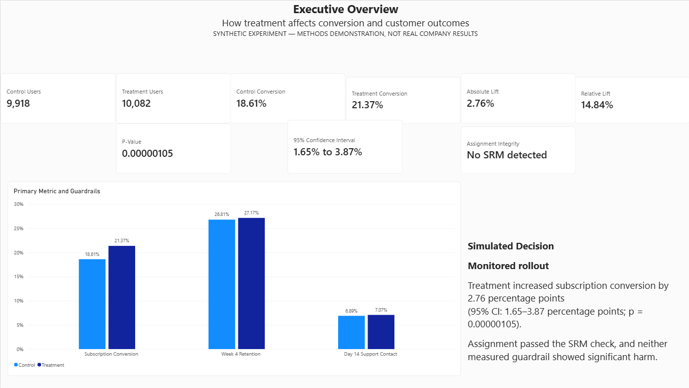
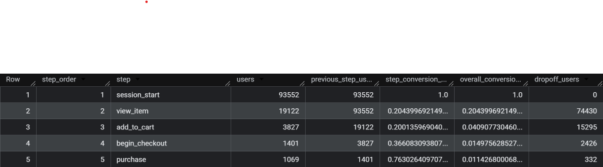
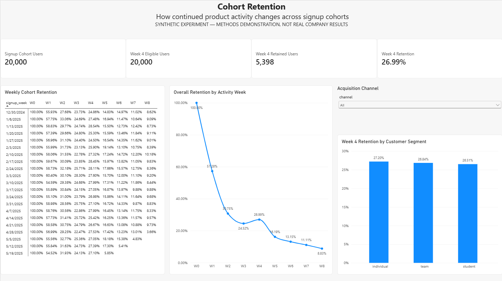
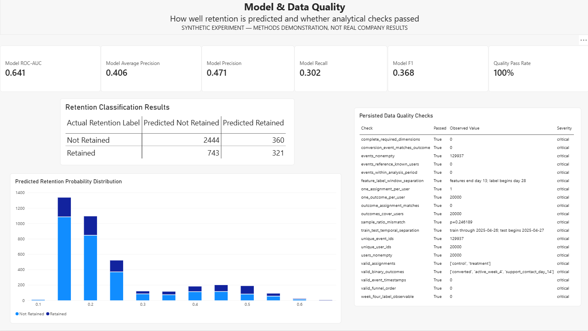
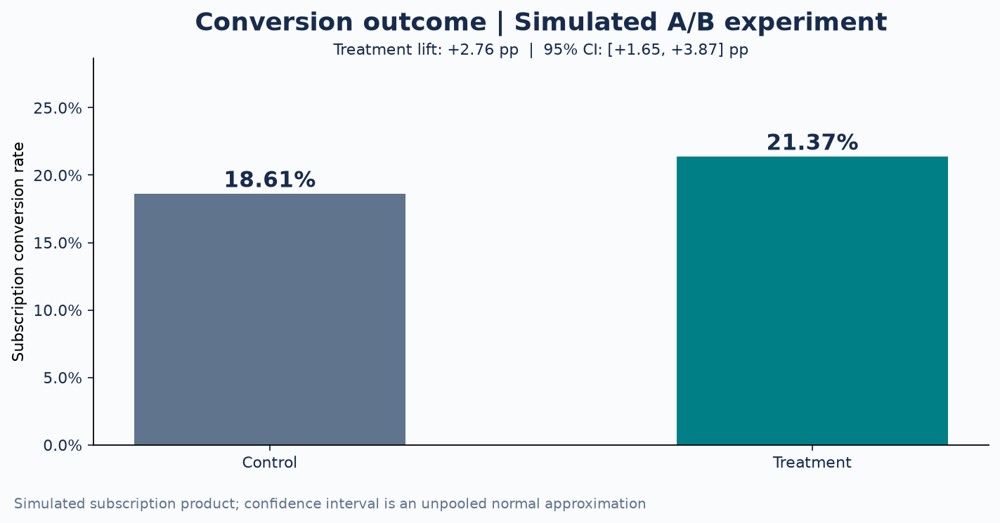
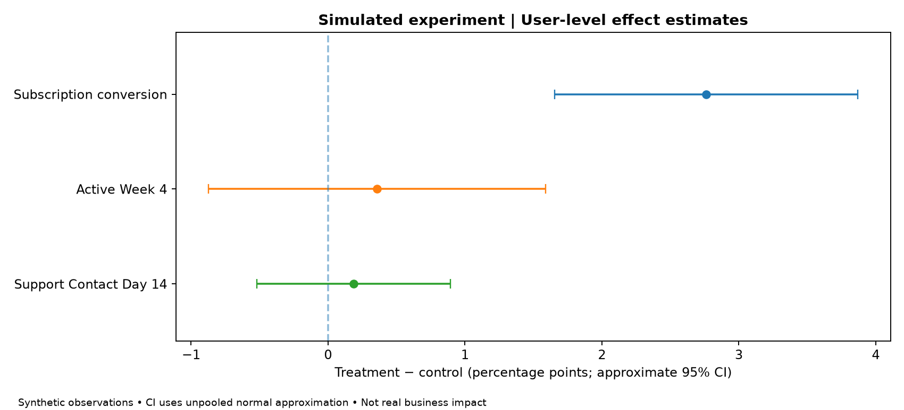
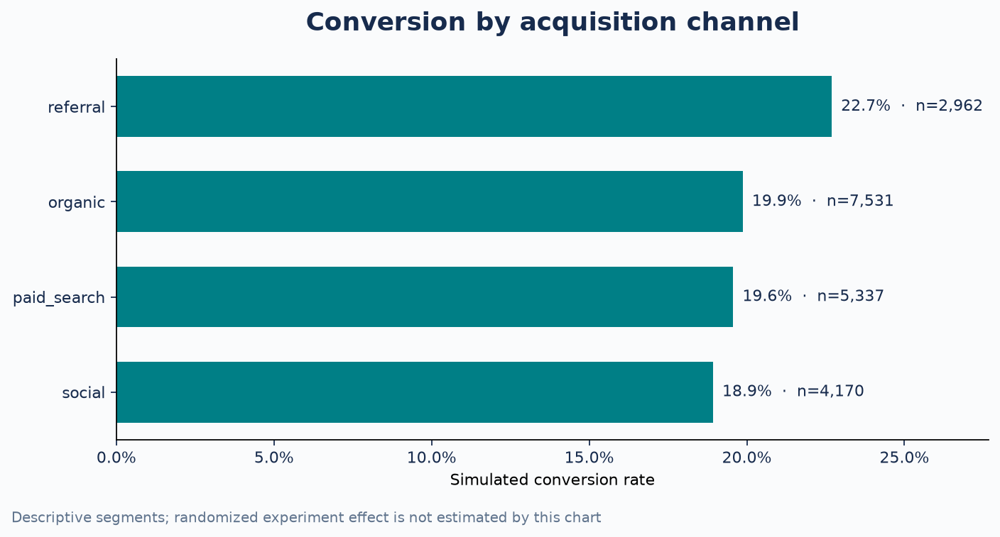
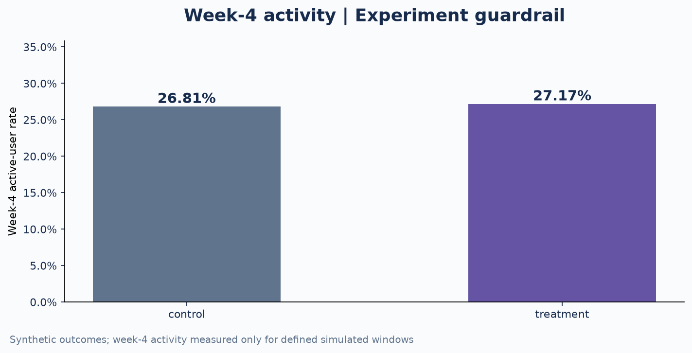
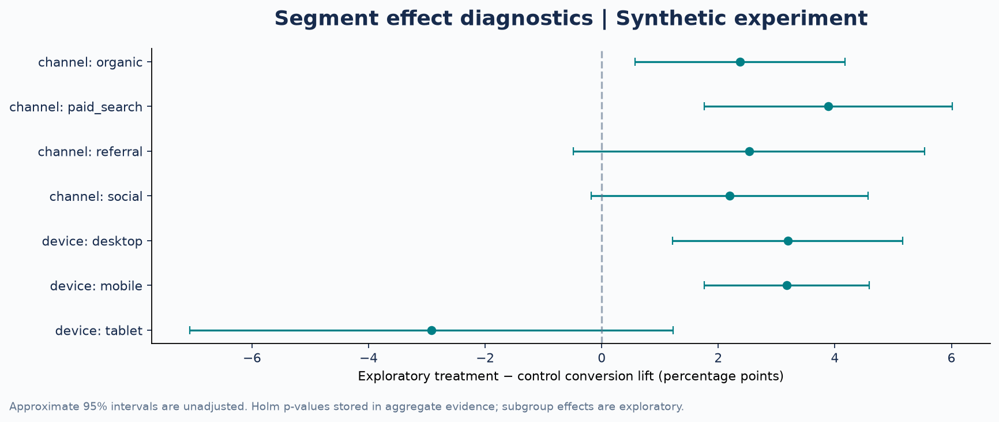
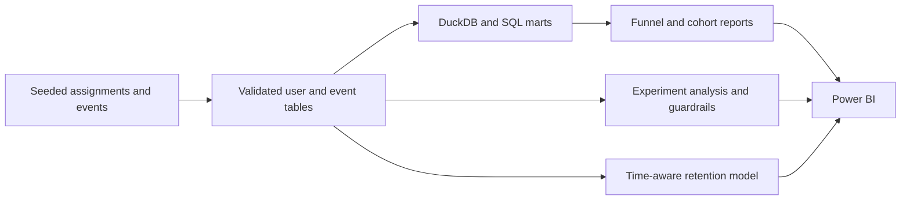

# Product Experimentation & Customer Analytics

**An end-to-end product analytics project combining randomized-experiment evaluation, SQL funnels, retention modeling, and executive reporting.**

**Python · SQL · DuckDB · SciPy · scikit-learn · BigQuery · Power BI · GitHub Actions**



[**Dashboard gallery**](#dashboard-gallery) · [**Results**](#selected-results) · [**Experiment evidence**](#experiment-and-retention-evidence) · [**Architecture**](#solution-architecture) · [**Technical evidence**](#technical-evidence)

## Project overview

A subscription-product analytics case study spanning acquisition, conversion, and customer retention. The system models user-level experiment assignments and behavioral events, builds funnel and cohort views in DuckDB, evaluates treatment effects and guardrails, and reports retention-model performance.

**Data scope:** The controlled experiment uses reproducible **synthetic data**, not real users or observed company results. The separate public GA4 analysis, where included, uses an independent obfuscated ecommerce dataset.

## Selected results

| Area | Verified simulated-run result | Evidence |
|---|---|---|
| Experiment scale | **20,000 simulated users**; 129,937 generated events | [Aggregate results](docs/evidence/showcase/experiment_validity.json) |
| Conversion | **18.61% → 21.37%** (control → treatment) | [Experiment decision memo](docs/evidence/showcase/experiment_validity_memo.md) |
| Treatment effect | **+2.76 percentage points**, approximate 95% CI **[+1.65, +3.87]**; p = **1.05e-06** | [Methods](docs/EXPERIMENT_VALIDITY_METHOD.md) |
| Allocation quality | SRM p = **0.2462**; not flagged | [Aggregate results](docs/evidence/showcase/experiment_validity.json) |
| Reporting | Four-page Power BI report and validated user-grain SQL views | [Power BI measures](docs/power_bi.md) |

The experiment's treatment effect is embedded in a deterministic simulation; its measured lift demonstrates analytical implementation rather than live business impact.

## Dashboard gallery

The reporting layer brings the experiment, acquisition funnel, customer cohorts, and model/data quality into one Power BI experience.

| Executive overview | Conversion funnel |
| :---: | :---: |
| [](docs/images/dashboard-executive-overview.png) | [](docs/images/bigquery-ga4-funnel-results.png) |

| Cohort retention | Model and data quality |
| :---: | :---: |
| [](docs/images/dashboard-cohort-retention.png) | [](docs/images/dashboard-model-data-quality.png) |

## Experiment and retention evidence

**Experiment outcome and uncertainty.** The primary treatment effect was evaluated using user-level assignments and an independent control-versus-treatment comparison. Guardrails and sample-ratio checks accompany the result.

| Conversion by assignment | Effect estimates and guardrails |
|:---:|:---:|
| [](docs/images/showcase_conversion.png) | [](docs/images/showcase_effects.png) |

The chronologically evaluated retention model achieved **0.641 ROC-AUC** and **0.406 average precision** on the reported 20,000-user simulation holdout. This is modest predictive discrimination, not evidence of successful intervention.

<details>
<summary><strong>Additional analysis: channels, retention and segments</strong></summary>

| Acquisition channels | Week-4 activity |
| :---: | :---: |
| [](docs/images/showcase_channel.png) | [](docs/images/showcase_retention.png) |

| Exploratory segments |
| :---: |
| [](docs/images/showcase_subgroups.png) |

Exploratory subgroup estimates are not independent confirmatory findings; their Holm-adjusted p-values are retained in the supporting evidence.

</details>

## Solution architecture



**Engineering highlights**

- **Event and user modeling:** separate event-grain observations from unique assignment and outcome records.
- **Experiment validity:** allocation checks, proportion inference, confidence intervals, practical-effect criteria, and guardrails.
- **Retention prediction:** chronological holdout and features available before the predicted observation window.
- **Business intelligence:** funnel abandonment, cohort retention, acquisition-channel comparisons, and model/quality reporting.
- **Quality:** deterministic generation, automated tests, code linting, and user-grain integrity checks.

## Separate public-data analysis

A BigQuery funnel analysis using Google's public, obfuscated GA4 ecommerce sample is included in [`sql/bigquery_ga4_funnel.sql`](sql/bigquery_ga4_funnel.sql). This is a separate dataset from the synthetic subscription experiment.

## Repository map

| Location | Contents |
|---|---|
| [`src/`](src/) and [`sql/`](sql/) | Data generation, model logic, DuckDB analytical views, BigQuery query |
| [`experiment_validity/`](experiment_validity/) | User-grain experiment diagnostics and uncertainty reporting |
| [`product_showcase/`](product_showcase/) | Aggregate evidence, analytics visuals, README generation |
| [`docs/`](docs/) | Architecture, Power BI notes, model card, and case-study evidence |
| [`tests/`](tests/), [`tests_experiment_validity/`](tests_experiment_validity/), [`tests_showcase/`](tests_showcase/) | Automated analytical and presentation checks |

## Technical evidence

[Experiment decision report](docs/evidence/showcase/experiment_validity_memo.md) · [Aggregate experiment results](docs/evidence/showcase/experiment_validity.json) · [Exploratory segments](docs/evidence/showcase/segment_effects.json) · [Retention model card](docs/RETENTION_MODEL_CARD_SHOWCASE.md) · [Architecture](docs/architecture.md) · [Power BI design](docs/power_bi.md)

<details>
<summary><strong>Reproducibility and local validation</strong></summary>

```powershell
python -m pip install -r requirements.txt
python -m pip install -r requirements-showcase.txt
python -m src.pipeline --users 20000 --days 180 --seed 42
python -m product_showcase.build --repo .
python -m pytest -q
```

Generated user-level datasets and local databases are not committed. The published charts are derived from aggregate simulation evidence.

</details>

## Data and interpretation

The treatment comparison is retrospective analysis of simulated outcomes, not a company A/B test or an observed causal business result. Nonsignificant guardrails do not establish equivalence. Real rollout decisions would require instrumentation verification, operational cost, and longitudinal evidence.

---

**Rishi Ratnakar** · [GitHub](https://github.com/RishiRatnakarData) · [LinkedIn](https://www.linkedin.com/in/rishi-ratnakar/)
