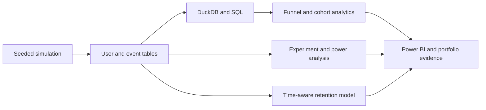

# Product Experimentation & Customer Analytics

**A product analytics and experimentation platform combining A/B test inference, behavioral funnels, cohort retention, predictive modeling, and executive reporting.**

**Stack:** Python · SQL · DuckDB · SciPy · scikit-learn · BigQuery · Power BI · GitHub Actions

> **Data scope:** The subscription experiment uses reproducible synthetic data, not real users or actual company performance. The public GA4 BigQuery extension is a separate dataset.

## Project highlights

| Experiment scale | Conversion lift | Experiment validation | Reporting |
|---|---|---|---|
| **20,000 simulated users** | **+2.76 pp** | **SRM p = 0.2462** | **4-page Power BI report** |

For this seeded synthetic run, conversion increased from **18.61% (control)** to **21.37% (treatment)**. The estimated absolute lift was **+2.76 pp** (approximate 95% CI: **+1.65 to +3.87 percentage points**, two-sided p = **1.05e-06**).

## Experiment and analytics showcase

### Experiment outcome


### Treatment effect and guardrails


### Acquisition-channel performance


### Retention guardrail


### Exploratory segment effects


Segment estimates are exploratory, and multiplicity-adjusted p-values are provided in the aggregate evidence.

## Power BI dashboard gallery

The four-page report connects acquisition funnels, randomized experiment outcomes, retention cohorts, model evaluation, and quality checks.

### Executive overview


### Conversion funnel


### Cohort retention


### Model and data quality


## Engineering and analytical work

| Workstream | Delivered capability |
|---|---|
| Data modeling | Seeded user assignments and event-level behavior with user-grain analytical outputs |
| Product analytics | Funnel abandonment, customer cohorts, acquisition segments, and conversion reporting |
| Experimentation | Two-proportion inference, effect-size confidence intervals, sample-ratio checks, Active Week 4 and Support Contact Day 14, and power planning |
| Predictive analytics | Chronologically evaluated week-four activity model with explicit outcome timing |
| Reporting | Power BI report plus committed portfolio graphics derived from aggregate metrics |
| Quality engineering | Automated tests, user-grain validation, no silent deduplication, and CI |

## Experiment decision context

**Analytical classification:** `candidate_for_monitored_review`. The treatment has an estimated lift of **+2.76 pp** relative to control on synthetic outcomes. This is a simulated analytical case study, not evidence of realized revenue, causal business impact at a company, or a completed live rollout.

The SRM test evaluates arm allocation. A nonsignificant guardrail result does **not** establish equivalence or prove the absence of harm. For deployment, longer observation windows, instrumentation audits, and commercially relevant constraints would remain necessary.

## Architecture



### Separate public-data analysis

The repository also includes `sql/bigquery_ga4_funnel.sql`, executed against Google's public, obfuscated GA4 ecommerce sample. This real-data SQL case study is distinct from the simulated subscription experiment.


## Technical evidence

- [Experiment validity and decision report](docs/EXPERIMENT_VALIDITY_METHOD.md)
- [Seeded-run aggregate evidence](docs/evidence/showcase/experiment_validity.json)
- [Exploratory subgroup estimates with Holm correction](docs/evidence/showcase/segment_effects.json)
- [Retention model card](docs/RETENTION_MODEL_CARD_SHOWCASE.md)
- [Existing architecture and data grains](docs/architecture.md)
- [Existing data dictionary](docs/data_dictionary.md)
- [Existing decision memo](docs/decision_memo.md)
- [Power BI documentation](docs/power_bi.md)

<details><summary>Reproducibility and local validation</summary>

```powershell
python -m pip install -r requirements.txt
python -m pip install -r requirements-showcase.txt
python -m src.pipeline --users 20000 --days 180 --seed 42
python -m product_showcase.build --repo .
python -m pytest -q
```

Generated user-level records and local databases are excluded from Git; published evidence contains aggregate results and screenshots.

</details>

## Author

**Rishi Ratnakar** · [LinkedIn](https://www.linkedin.com/in/rishi-ratnakar/) · [GitHub](https://github.com/RishiRatnakarData)
