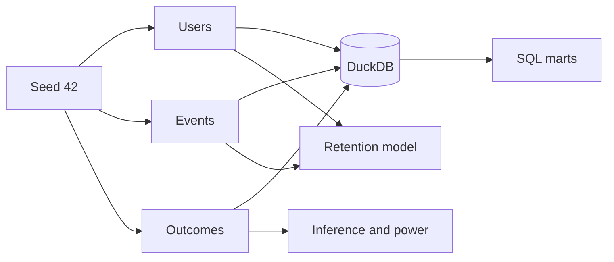

# Architecture and analytical design

## Components

The local system is intentionally credential-free. `generate.py` produces normalized tables, `local_models.sql` builds serving views, and `pipeline.py` persists all evidence needed by the memo and report. CI runs a smaller version of the same contract.

## Table grains

| Table or view | Grain | Primary key |
|---|---|---|
| `users` | One row per user and experiment assignment | `user_id` |
| `events` | One row per product event | `event_id` |
| `experiment_outcomes` | One row per user | `user_id` |
| `user_funnel` | One row per user with ordered step flags | `user_id` |
| `funnel` | One row per funnel step | `step_order` |
| `funnel_by_segment` | One row per channel, segment, and variant | Composite dimensions |
| `cohort_retention` | One row per signup week and activity week | `signup_week`, `week_number` |
| `experiment_results` | One row per analyzed metric | `metric` |
| `retention_predictions` | One row per holdout user | `user_id` |
| `quality_report` | One row per validation rule | `check_name` |

## Experiment design

Assignment is Bernoulli with probability 0.5 and a fixed random seed. Conversion probability varies with acquisition channel, device, and customer segment; treatment adds exactly 2.5 percentage points. The two-proportion z-test reports a two-sided p-value, while an unpooled standard error forms the confidence interval for the absolute difference. A chi-square goodness-of-fit test flags sample-ratio mismatch at p < 0.01.

The decision rule requires all of the following:

1. No SRM flag.
2. Primary p-value below 0.05.
3. Absolute conversion lift of at least one percentage point.
4. No significant decrease in week-four retention.
5. No significant increase in day-14 support contacts.

This rule is illustrative because the data are simulated. A real experiment would pre-register the rule, define exposure and exclusion logic, estimate costs, and inspect instrumentation before reading outcomes.

## Funnel and retention definitions

Funnel stages use the earliest timestamp for each event and require chronological order. Every user appears at most once in a stage count. Cohort activity means at least one `landing_view` or `app_open` during a seven-day interval relative to signup. A cohort/week row is emitted only when the entire interval is observable through the configured analysis end.

The retention model makes a prediction at the end of day 13. Features cover signup through day 13, and the positive label is an `app_open` during days 28–34. The chronological split prevents the same signup date from appearing in both training and test sets. Features do not include the label window or any later behavior.

## Trust boundaries

Local CI proves deterministic generation, SQL execution, inference behavior, leakage-window separation, and artifact creation. Separate author-run evidence verifies the BigQuery public-data query and the completed Power BI report against generated artifacts. The project does not claim production instrumentation, cloud deployment, or external validity.
